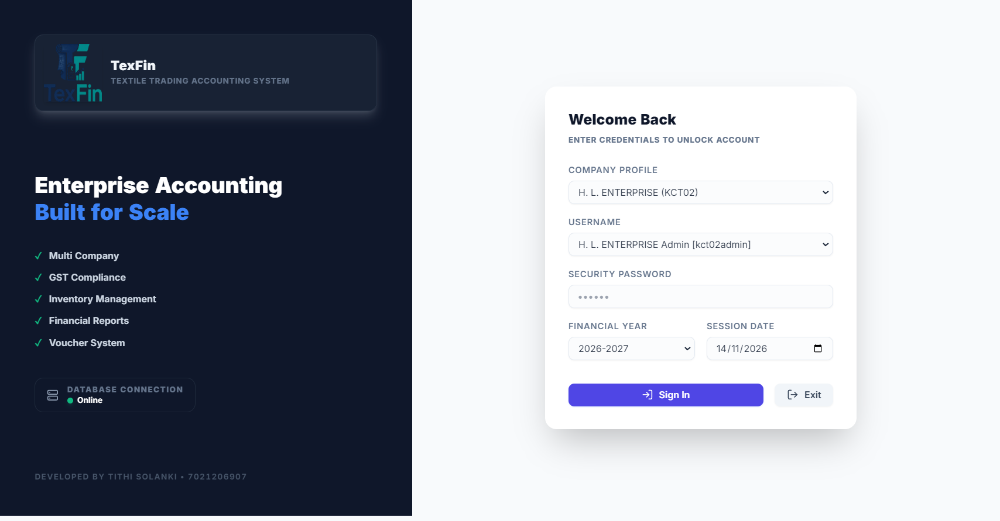
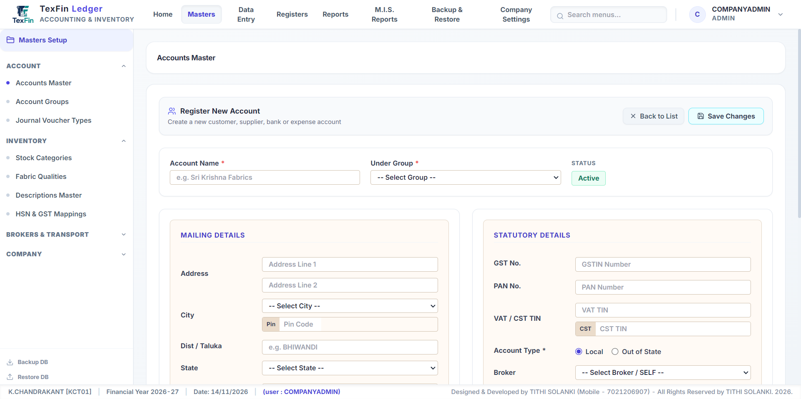
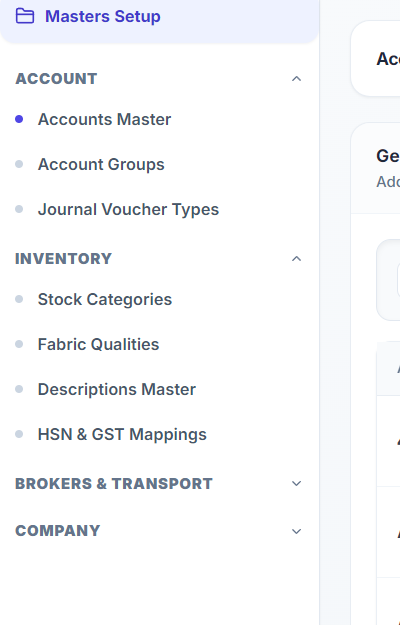

<div align="center">


# TexFin — Ledger

**Offline-first desktop accounting & inventory ERP for textile trading businesses**

[](https://www.electronjs.org/)
[](https://react.dev/)
[](https://www.typescriptlang.org/)
[](https://www.sqlite.org/)
[](LICENSE)

</div>

---

TexFin is a Windows desktop ERP built for Indian textile trading firms, replacing a legacy
DOS/Windows accounting package (**AC_PLUS**) with the same day-to-day workflows — multi-company
ledgers, GST-compliant invoicing, double-entry bookkeeping, and stock tracking — in a modern,
offline-capable desktop app with optional cloud sync.

## Screenshots

<table>
<tr>
<td width="50%"><br/><sub>Multi-company login</sub></td>
<td width="50%"><br/><sub>Account master form</sub></td>
</tr>
<tr>
<td width="50%"><br/><sub>Collapsible sidebar navigation</sub></td>
<td width="50%" valign="top">

**At a glance**
- Multi-company, multi-financial-year
- Role-based access (Admin / User)
- GST-aware vouchers with PDF output
- Offline SQLite, optional Supabase sync

</td>
</tr>
</table>

## Features

- **Multi-company accounting** — switch between companies and financial years from one login screen, each with its own ledgers, inventory, and users.
- **Double-entry vouchers** — Sales Invoice, Purchase Bill, Delivery Challan, Bank/Cash Payment & Receipt, Journal Voucher, Credit/Debit Note, bill-wise allocation entries.
- **GST handling** — automatic CGST/SGST vs. IGST split based on company/customer state, HSN-wise GST mapping.
- **Reports & registers** — Trial Balance, Party Ledger, Outstanding & Ageing, Overdue Interest, Sales/Purchase/Journal Registers, with print-ready and CSV/Excel export.
- **Inventory** — fabric quality, category, and description masters with piece/meter stock tracking.
- **PDF generation** — multi-copy invoice/challan printing, ledger statements, allocation reports.
- **Offline-first** — runs entirely on a local SQLite database; an optional Supabase-backed sync layer keeps multiple machines in sync when online.
- **AC_PLUS data import** — a dedicated tool (`scripts/acplus/`) migrates an existing AC_PLUS Access database into TexFin, self-verifying every account's trial balance against the source.

## Tech stack

| Layer | Technology |
|---|---|
| Desktop shell | Electron |
| UI | React 18 + TypeScript, Tailwind CSS, Zustand, React Hook Form + Zod |
| API | Express.js (embedded in the Electron main process) |
| Database | SQLite (local), Supabase (optional cloud sync) |
| Auth | JWT + bcrypt |
| Documents | pdf-lib (PDF), xlsx (Excel) |
| Build | Vite, electron-builder |

## Getting started

```bash
# Install dependencies
npm install

# Run in development mode (Vite + Electron, hot reload)
npm run dev

# Run the backend integration test suite
npm run test:backend

# Build a production Windows installer
npm run package
```

The packaged installer lands in `release/`. In development, create a `.env` file (see
`db/` and `src/backend/` for the variables it reads — `PORT`, `DB_PATH`, `JWT_SECRET`,
and optionally `SUPABASE_URL` / `SUPABASE_KEY` for cloud sync).

## Project structure

```
src/
├── backend/          # Express API: controllers, services, repositories, routes
│   ├── db/            # SQLite connection, migrations, seed data
│   └── middleware/    # JWT auth
├── electron/          # Electron main process + preload bridge
├── frontend/          # React app
│   ├── app/            # Shell: top nav, sidebar, routing
│   ├── components/     # Shared UI primitives (Button, Input, Table, Modal, ConfirmModal...)
│   ├── modules/         # Feature modules: masters, vouchers, registers, reports, opening balances
│   ├── pages/           # Top-level routed pages
│   ├── services/        # API client layer
│   └── store/           # Zustand global store
└── shared/            # Types shared between frontend and backend
db/                   # SQL schema, Supabase schema, seed scripts
scripts/              # Build helpers and the AC_PLUS data-import tool
tests/                # Backend integration tests
```

## License

Proprietary — All Rights Reserved. See [LICENSE](LICENSE). This repository is public for
portfolio and demonstration purposes; no reuse, modification, or redistribution is permitted
without written permission from the author.

## Author

**Tithi Solanki** — [github.com/tithisolanki](https://github.com/tithisolanki)
